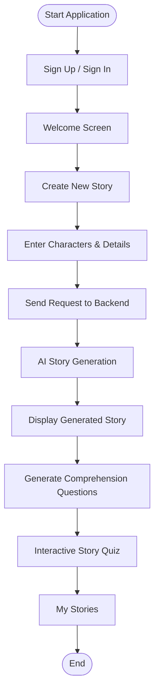
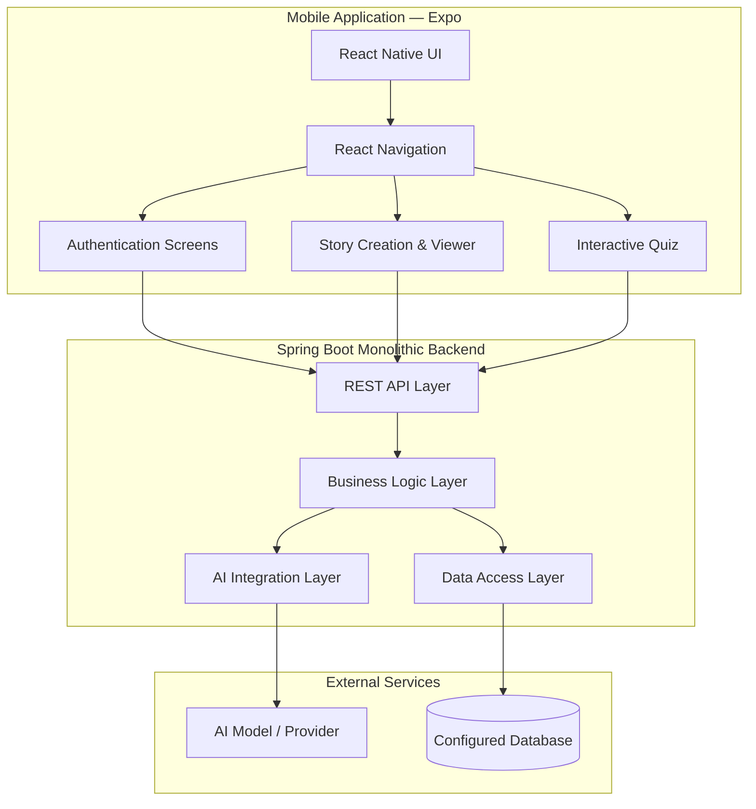

# ✨ Story Spark — AI-Powered Interactive Storytelling

**Turn imagination into stories. Make every story an adventure.**

Story Spark is an AI-powered interactive storytelling application designed to help children explore their creativity through personalized stories and educational activities.

Children can create their own stories by providing characters and story details. Artificial intelligence transforms their ideas into engaging narratives and generates comprehension questions to make reading more interactive and educational.

Built with **React Native (Expo)** and **Spring Boot**, Story Spark combines cross-platform mobile development with AI-powered backend services to deliver an engaging storytelling experience.

---

## 📌 Table of Contents

- [Overview](#-overview)
- [The Problem](#-the-problem)
- [Our Solution](#-our-solution)
- [Features](#-features)
- [Application Workflow](#-application-workflow)
- [Technology Stack](#-technology-stack)
- [Architecture](#-architecture)
- [Project Structure](#-project-structure)
- [Getting Started](#-getting-started)
- [Backend Setup](#-backend-setup)
- [Frontend Setup](#-frontend-setup)
- [Configuration](#-configuration)
- [Application Screens](#-application-screens)
- [Future Improvements](#-future-improvements)
- [Contributing](#-contributing)
- [License](#-license)

---

## 🌟 Overview

Traditional storytelling is often limited to predefined books and stories. Children consume stories rather than actively participating in creating them.

Story Spark introduces a different approach: **children become the creators of their own adventures.**

By combining artificial intelligence with an interactive mobile experience, the application allows children to:

- Create personalized stories using their own characters and ideas.
- Explore AI-generated narratives.
- Read and interact with generated stories.
- Test their understanding through AI-generated comprehension quizzes.
- Manage their stories and personal profiles.

Our goal is to make storytelling more creative, interactive, and educational.

---

## 🎯 The Problem

Children need engaging ways to develop their imagination, reading comprehension, and creativity.

However, traditional storytelling applications often present static content with limited personalization and interaction.

Some of the main challenges include:

- Limited opportunities for children to influence story creation.
- Repetitive storytelling experiences.
- Lack of personalized educational content.
- Limited integration between storytelling and reading comprehension activities.

## 💡 Our Solution

Story Spark uses AI to transform children's ideas into personalized storytelling experiences.

Instead of simply selecting an existing story, children participate in the creative process by providing characters and story details.

The application then generates a narrative and complementary comprehension questions, connecting creativity with learning.

---

## 🚀 Features

### 📖 AI-Powered Story Generation

- Generate personalized stories using artificial intelligence.
- Create narratives based on user-provided characters and story details.
- Transform simple ideas into engaging storytelling experiences.

### 🧠 Interactive Learning & Quizzes

- Generate comprehension questions based on stories.
- Encourage children to understand and remember what they read.
- Combine entertainment with educational activities.

### 🔐 Authentication & User Management

- User registration.
- User sign-in.
- Forgot-password interface.
- Personal profile management.

### 📚 My Stories

- Access the stories section.
- Manage the storytelling experience from a dedicated interface.

### ⚙️ Settings & Personalization

- Dedicated application settings screen.
- User profile interface.

### 📱 Cross-Platform Mobile Experience

- Built with React Native and Expo.
- Designed for mobile application development.
- Native navigation using React Navigation.

---

## 🔄 Application Workflow

The main application workflow follows these steps:

1. **Authentication:** The user creates an account or signs in.
2. **Story Creation:** The child provides characters and details for a new story.
3. **AI Generation:** The backend processes the input and generates a personalized narrative.
4. **Story Exploration:** The generated story is presented through the mobile application.
5. **Knowledge Assessment:** The child answers comprehension questions related to the story.
6. **Story Management:** The user can access the stories section and manage their application experience.

### Story Generation Flow



---

## 🛠️ Technology Stack

Story Spark uses a mobile frontend and a centralized backend architecture.

### Frontend

| Technology | Purpose |
|---|---|
| React Native | Cross-platform mobile development |
| Expo SDK 53 | Development and application tooling |
| React 19 | UI development |
| JavaScript | Application logic |
| React Navigation 7 | Screen navigation |
| AsyncStorage | Local asynchronous storage |
| React Native Picker | Selection components |
| Expo Status Bar | Status bar management |

### Backend

| Technology | Purpose |
|---|---|
| Java | Backend programming language |
| Spring Boot | Backend application framework |
| Spring Web | HTTP API development |
| Spring Boot Monolith | Centralized backend architecture |
| AI Integration | Story and quiz generation |

*Note: The backend table describes the confirmed backend direction. Specific AI providers, database technologies, authentication mechanisms, and additional dependencies should be documented according to the actual backend configuration.*

---

## 🏗️ Architecture

Story Spark follows a client-server architecture.

The mobile application handles user interaction, navigation, and presentation, while the Spring Boot backend centralizes application logic and AI-powered functionality.



### Architectural Responsibilities

**Mobile Application**
- Provides the user interface.
- Manages screen navigation.
- Collects story creation inputs.
- Displays generated stories and quizzes.
- Provides authentication and profile screens.

**Spring Boot Backend**
- Exposes backend functionality to the mobile application.
- Processes incoming requests.
- Handles application business logic.
- Coordinates AI-powered story generation.
- Supports comprehension question generation.

**AI Integration**
- Processes user-provided storytelling inputs.
- Generates personalized narratives.
- Produces educational comprehension questions.

---

## 📂 Project Structure

The repository is organized into a mobile application and a backend project.

```text
Story-Spark-App/
│
├── Backend/
│   └── story-spark/
│       └── Spring Boot Backend
│
├── Components/
│   ├── Authentication_Components/
│   │   ├── Sign_Up.js
│   │   ├── Sign_In.js
│   │   └── Forgot_Password.js
│   │
│   ├── CreateNewStory/
│   │   └── input_details.js
│   │
│   ├── Welcome_Page.js
│   ├── Show_Story.js
│   ├── StoryQuiz.js
│   ├── MyStories_Comp.js
│   ├── Settings_Comp.js
│   └── Profile_Screen.js
│
├── assets/
│   └── Application assets
│
├── App.js
├── index.js
├── app.json
├── package.json
├── package-lock.json
└── .gitignore
```

*The mobile component names above reflect the repository's current navigation imports. The backend's internal package structure is intentionally not assumed.*

---

## ⚡ Getting Started

Follow these instructions to set up the project locally.

### Prerequisites

Make sure you have installed:

- Node.js (compatible with Expo SDK 53).
- npm.
- Git.
- Java Development Kit (JDK) compatible with the backend configuration.
- Maven, if it is not included through the backend Maven Wrapper.
- Android Studio or Xcode for native emulator development (optional).
- Expo Go for testing on a compatible physical device.

### 1. Clone the Repository

```bash
git clone https://github.com/moonmido/Story-Spark-App.git

cd Story-Spark-App
```

### 2. Backend Setup

Navigate to the Spring Boot backend:

```bash
cd Backend/story-spark
```

Build the backend:

```bash
./mvnw clean install
```

On Windows:

```bash
mvnw.cmd clean install
```

If the project does not contain Maven Wrapper files, use:

```bash
mvn clean install
```

Run the application:

```bash
./mvnw spring-boot:run
```

On Windows:

```bash
mvnw.cmd spring-boot:run
```

The backend should start on the port configured in its Spring Boot application properties.

### 3. Frontend Setup

Open another terminal and navigate to the project root:

```bash
cd Story-Spark-App
```

Install dependencies:

```bash
npm install
```

Start the Expo development server:

```bash
npm start
```

Or use the platform-specific commands:

```bash
# Android
npm run android

# iOS
npm run ios

# Web
npm run web
```

### 4. Run the Application

After starting Expo:

- Scan the QR code using Expo Go on your mobile device.
- Or launch an Android/iOS emulator.
- Make sure the mobile application can communicate with the running backend.

---

## ⚙️ Configuration

### Backend Configuration

Configure the backend using its existing Spring Boot configuration files.

Common configuration locations include:

```text
Backend/story-spark/
└── src/
    └── main/
        └── resources/
            └── application.properties
```

Configure the following according to the backend implementation:

- Server port.
- AI provider credentials.
- AI model configuration.
- Database connection, if configured.
- Authentication and security settings.

**Security recommendation:** Never commit API keys, passwords, database credentials, or other secrets to GitHub. Use environment variables or a local environment configuration excluded from version control.

### Frontend Configuration

The mobile application needs to communicate with the backend through its API base URL.

For local development:

- Android emulator: use the host machine address reachable from the emulator.
- iOS simulator: use the host machine's local address.
- Physical device: use your computer's LAN IP address.
- Production: use the deployed backend HTTPS URL.

Avoid using `localhost` as the backend address when testing from a physical mobile device.

---

## 📱 Application Screens

The application navigation currently includes the following screens:

| Screen | Description |
|---|---|
| Sign Up | Create a user account |
| Sign In | Authenticate an existing user |
| Forgot Password | Password recovery interface |
| Welcome | Main welcome experience |
| Story Details | Enter characters and story details |
| Show Story | Display generated storytelling content |
| Story Quiz | Interactive comprehension questions |
| My Stories | Stories management interface |
| Profile | User profile |
| Settings | Application settings |

---

## 🔮 Future Improvements

Potential directions for extending Story Spark include:

- 🎨 AI-generated illustrations for individual story scenes.
- 🔊 Text-to-speech narration.
- 🌍 Multilingual storytelling.
- 👶 Age-adaptive storytelling and educational content.
- 📚 Advanced story library with search and filtering.
- ⭐ Favorites and personalized recommendations.
- 🎮 More interactive story choices and branching narratives.
- 📊 Learning progress and reading comprehension analytics.
- 🔒 Enhanced parental controls and child-friendly privacy features.
- ☁️ Cloud synchronization across devices.

---

## 🤝 Contributing

Contributions are welcome!

If you want to improve Story Spark, you can contribute by:

1. Forking the repository.
2. Creating a feature branch.
3. Implementing your changes.
4. Testing your implementation.
5. Submitting a Pull Request.

Example:

```bash
# Fork and clone your repository
git clone https://github.com/YOUR_USERNAME/Story-Spark-App.git

cd Story-Spark-App

# Create a feature branch
git checkout -b feat/your-feature

# Commit your changes
git add .
git commit -m "feat: add your feature"

# Push the branch
git push origin feat/your-feature
```

Please ensure that your contributions follow the existing project conventions.

---

## 📄 License

A license has not yet been specified in the repository.

If you intend to distribute this project as open source, consider adding an appropriate license file, such as MIT, after deciding on the licensing terms.

---

## 👨‍💻 Author

**Abd Elmoudjib Boutmedjet**

GitHub: [@moonmido](https://github.com/moonmido)

Project Repository: [Story-Spark-App](https://github.com/moonmido/Story-Spark-App)

---

## ⭐ Support the Project

If you find Story Spark interesting, consider giving the repository a star ⭐.

Your support helps encourage further development and improvements.

**Story Spark — Every child has a story worth telling.** ✨
